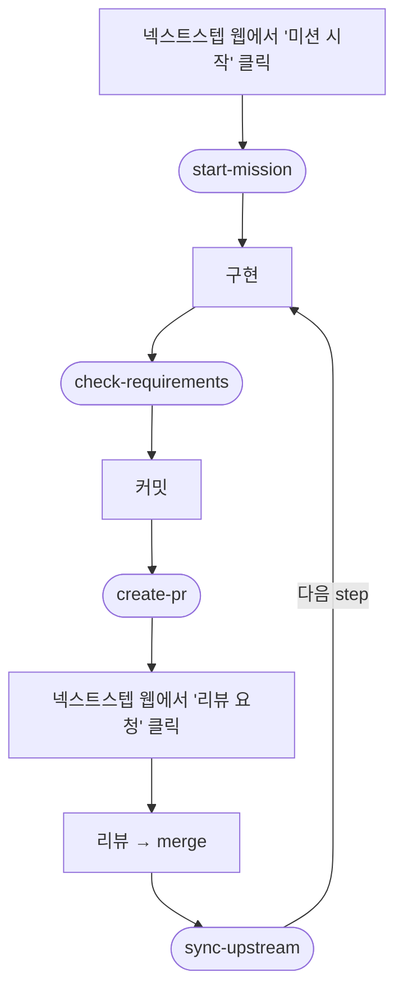

# nextstep-skills

[넥스트스텝(NextStep)](https://edu.nextstep.camp) 미션의 Git/GitHub 절차를 도와주는 AI 코딩 에이전트용 스킬 모음입니다. [Claude Code](https://claude.com/claude-code) 플러그인으로 설치하며, 같은 SKILL.md 형식을 읽는 Codex·pi에서도 설치할 수 있습니다.

넥스트스텝 미션은 fork → 아이디 브랜치 기준 작업 → PR → merge 후 upstream 동기화라는, 처음엔 꽤 헷갈리는 Git 절차를 요구합니다. 이 스킬들은 그 절차에서 **본인 아이디·저장소 이름 같은 빈칸을 Claude가 직접 읽어 채우고**, 위험한 명령은 확인을 받으며 진행해 줍니다.

## 설치

> Claude Code, Codex, pi 모두 **CLI 환경에서만 테스트**했습니다. 데스크톱 앱·IDE 확장 등 다른 환경에서는 동작이 다를 수 있습니다.

<details>
<summary><h3>Claude Code</h3></summary>

터미널에서 실행하세요.

```
claude plugin marketplace add parkchu/nextstep-skills
claude plugin install nextstep@nextstep-skills
```

**업데이트** — 새 버전은 자동으로 들어오지 않습니다. 아래 명령으로 받은 뒤 Claude Code를 다시 시작하세요. 자동 업데이트를 원하면 Claude Code 대화창에서 `/plugin` → Marketplaces → `nextstep-skills` → **Enable auto-update**를 켜세요.

```
claude plugin update nextstep@nextstep-skills
```

**삭제**

```
claude plugin marketplace remove nextstep-skills
```

</details>

<details>
<summary><h3>Codex</h3></summary>

터미널에서 실행하세요.

```
codex plugin marketplace add parkchu/nextstep-skills
codex plugin add nextstep@nextstep-skills
```

**업데이트**

```
codex plugin marketplace upgrade nextstep-skills
```

**삭제**

```
codex plugin remove nextstep@nextstep-skills
codex plugin marketplace remove nextstep-skills
```

</details>

<details>
<summary><h3>pi</h3></summary>

터미널에서 실행하세요.

```
pi install git:github.com/parkchu/nextstep-skills
```

**업데이트**

```
pi update git:github.com/parkchu/nextstep-skills
```

**삭제**

```
pi remove git:github.com/parkchu/nextstep-skills
```

</details>

## 사용법

> [!WARNING]
> **Codex 사용 시 주의** — 권한을 **Full Access**로 설정하세요. 기본 샌드박스에서는 네트워크 접근과 작업 디렉토리 밖 쓰기가 막혀 `gh`·`git push`·clone 같은 단계가 실패합니다. Codex 대화창에서 `/permissions` → **Full Access**를 고르거나, `codex --sandbox danger-full-access`로 실행하세요.

스킬 이름 뒤에 인자를 붙여 부릅니다. 스킬 이름 앞에 붙는 접두사만 에이전트마다 다릅니다 — Claude Code는 `/nextstep:`, Codex는 `$nextstep:`, pi는 `/skill:`입니다.

<table>
  <tr>
    <th width="240">스킬</th>
    <th width="170">언제</th>
    <th>하는 일</th>
  </tr>
  <tr>
    <td><b>start-mission</b> <code>미션 저장소 URL</code></td>
    <td>새 미션을 처음 시작할 때</td>
    <td>fork+clone(gh CLI, 없으면 브라우저 폴백), upstream remote 세팅, 아이디 브랜치를 fork에 올리기, 최초 작업 브랜치(step1) 생성</td>
  </tr>
  <tr>
    <td><b>check-requirements</b> <code>미션 요구사항</code></td>
    <td>구현 중·커밋 전 수시로</td>
    <td>붙여넣은 미션 요구사항(텍스트나 캡처 이미지)을 diff와 대조해 조건별 ✅충족/❌미충족/⏸판단보류 체크리스트로 피드백</td>
  </tr>
  <tr>
    <td><b>create-pr</b> <code>PR 제목</code> (선택)</td>
    <td>단계 구현을 마치고 커밋한 뒤</td>
    <td>push 후 base(본인 아이디 브랜치)/head와 제목(인자, 없으면 <code>step1 - 아이디</code>)이 미리 채워진 PR 생성 링크 제공. 본문·PR 생성은 본인이</td>
  </tr>
  <tr>
    <td><b>sync-upstream</b></td>
    <td>리뷰가 끝나 PR이 merge된 뒤 (미션을 다 끝낸 뒤에도)</td>
    <td>merge 여부 확인 후 끝난 브랜치 정리, upstream fetch·rebase 동기화. 다음 step 브랜치 생성은 선택(merge 전이면 마지막 step 브랜치 기준). 충돌 해결 절차 포함</td>
  </tr>
</table>

예시 (Claude Code)

```
/nextstep:start-mission https://github.com/next-step/java-racingcar
/nextstep:check-requirements (미션 요구사항 텍스트를 붙여넣거나 캡처 이미지를 첨부)
/nextstep:create-pr 1단계 - 자동차 경주  ← 제목은 선택 (생략 시 step1 - 아이디)
/nextstep:sync-upstream
```

인자를 빼먹어도 괜찮습니다 — 스킬이 필요한 정보(저장소 URL, 미션 조건)를 물어봅니다. \
자연어로 요청해도 해당 스킬이 자동으로 잡힙니다. (예: "미션 시작하려는데 저장소 세팅해줘")

**start-mission 사용 시 알아둘 것**

- **미션 저장소 주소가 필요합니다.** 넥스트스텝 미션 페이지에 있는 GitHub 저장소 URL(예: `https://github.com/next-step/java-racingcar`)을 함께 알려주세요. 안 알려주면 스킬이 어느 미션인지 물어봅니다.
- **clone 위치는 에이전트를 실행한 현재 디렉토리 바로 아래**(`./저장소이름`)입니다. 위치를 따로 묻지 않으니, 미션 저장소들을 모아둘 디렉토리에서 실행하세요.

## 미션 흐름



둥근 칸은 스킬, 네모 칸은 스킬 없이 진행하는 단계입니다.
